Gosto de construir aplicações web pensando em quem vai usá-las. O front-end é a parte que mais me atrai, especialmente quando uma decisão na interface facilita uma tarefa que parecia complicada.

Busco uma oportunidade em desenvolvimento Full Stack. No meu , você encontra meu currículo, minha trajetória e o trabalho que desenvolvi para o portal Goiás de Norte a Sul.

## Projetos

<table>
  <tr>
    <td width="30%" align="center"></td>
    <td> O painel web organiza as sessões. No aplicativo, o cliente escolhe o assento e pode consultar o ingresso mesmo sem internet. 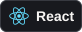 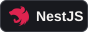  </td>
  </tr>
  <tr>
    <td width="30%" align="center"><a href="assets/leapy.png">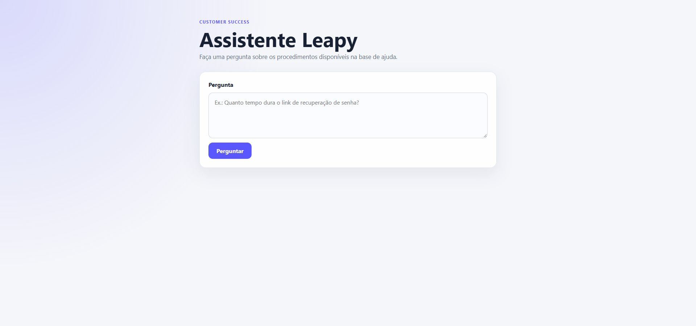</a></td>
    <td> O time de atendimento faz uma pergunta e recebe a resposta junto com o trecho da documentação que a fundamenta.  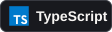 </td>
  </tr>
  <tr>
    <td width="30%" align="center"><a href="assets/cowork.png">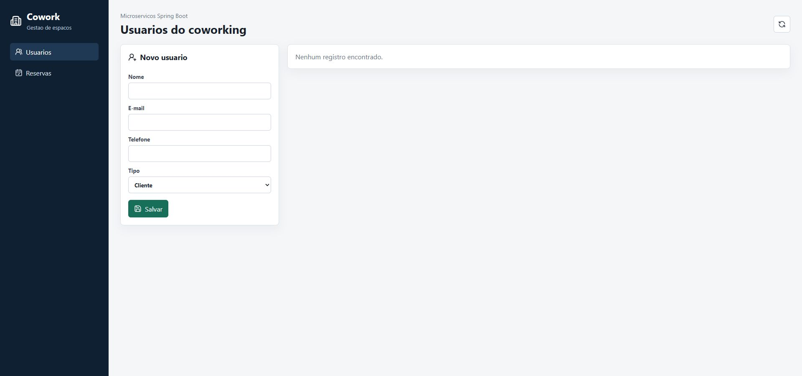</a></td>
    <td> Antes de confirmar uma reserva de sala, o serviço de reservas consulta o cadastro de usuários. A interface reúne as duas operações.  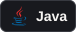 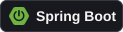</td>
  </tr>
</table>

## Tecnologias

  <strong>Front-end</strong> 
  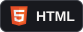
  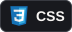
  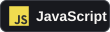
  
  
  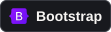

  <strong>Back-end</strong> 
  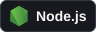
  
  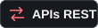

  <strong>Dados</strong> 
  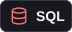
  
  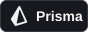

  <strong>Mobile</strong> 
  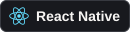
  

  <strong>Sites</strong> 
  
  

  <strong>Outras linguagens e ferramentas</strong> 
  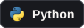
  
  
  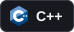
  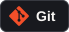

## Trilha de contribuições

  
  

  
  &ensp;&ensp;
  

## Contato

  
  
  <a href="https://www.instagram.com/wellfefe/">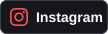</a>

Quer criar um site? .
